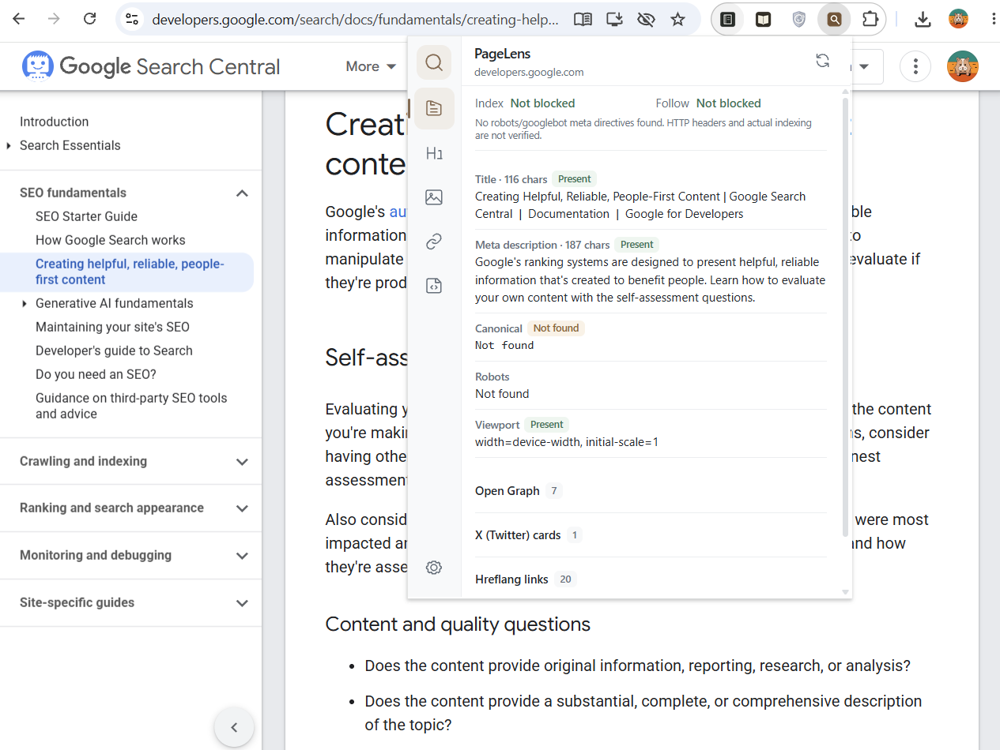
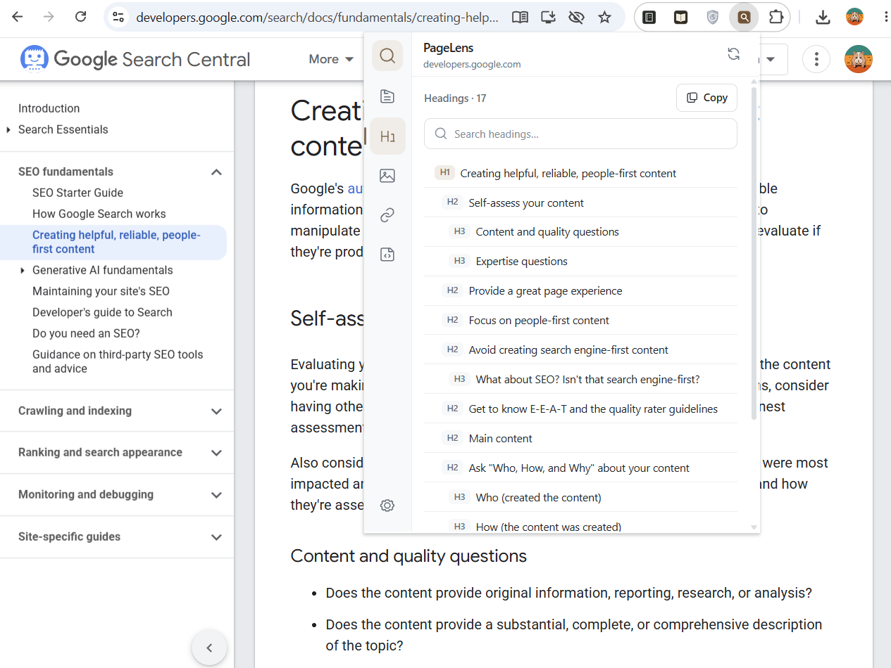
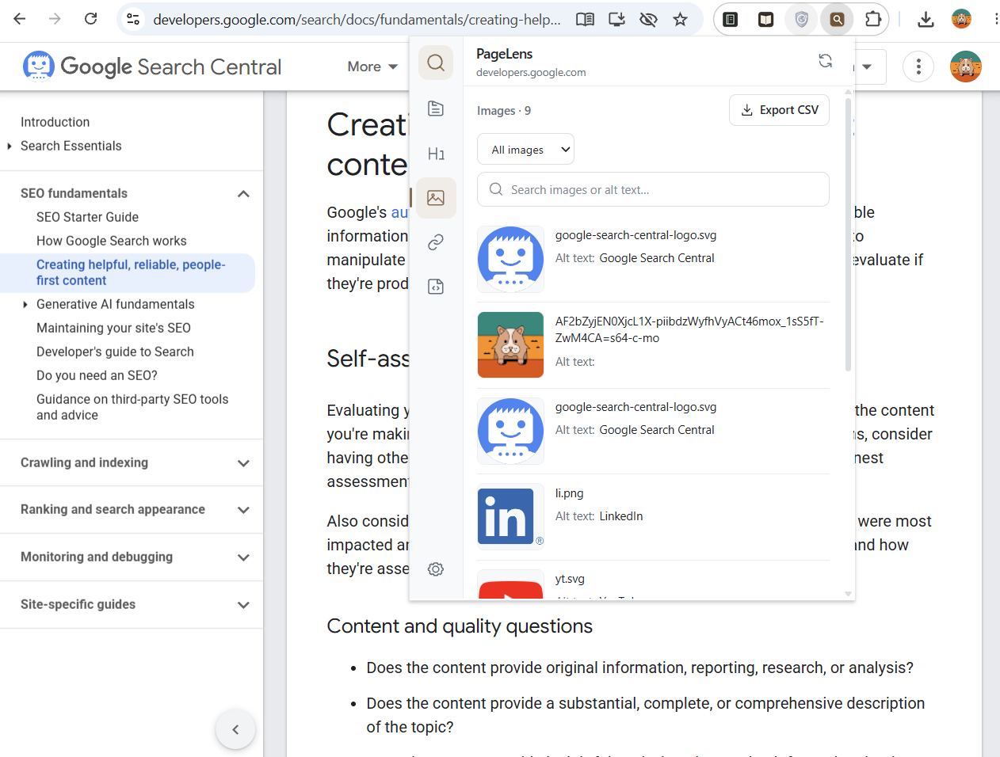
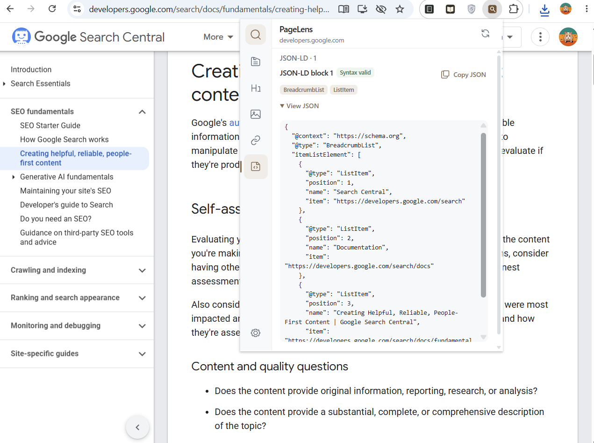
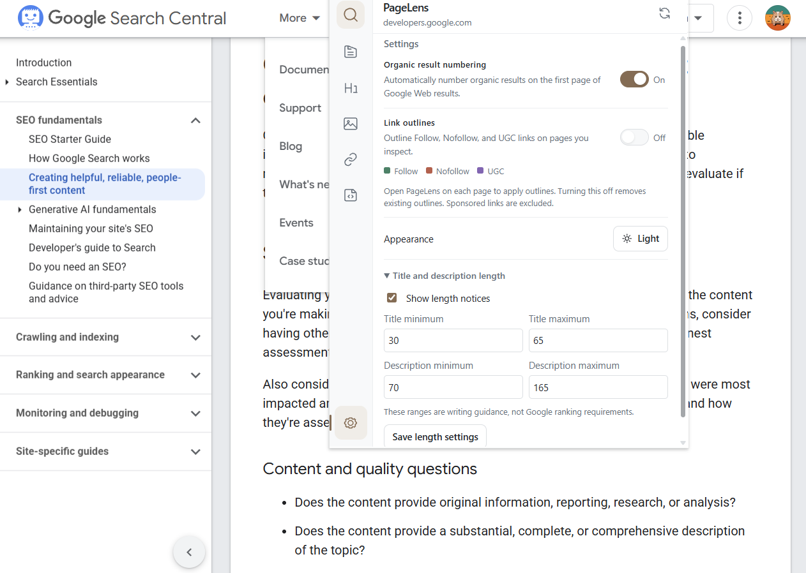

# PageLens

**A clearer look at the page you're on.**

PageLens is an open-source Chrome extension that makes webpage inspection straightforward. Open the popup to check metadata, heading structure, image alt text, links, and JSON-LD — without a dense dashboard or made-up SEO scores.

**v1.5.0 Beta** · Chrome 116+ · Manifest V3 · [Build status](https://github.com/reika140/pagelens/actions/workflows/ci.yml) · [MIT License](LICENSE)



*Metadata comes first: indexing directives, page title, description, canonical, and sharing tags. Captured from an installed extension on Google Search Central.*

<details>
<summary>See more screenshots — Headings, Images, JSON-LD, and Settings</summary>

**Heading structure**



**Image names and alt text**



**Structured data**



**Preferences**



</details>

*All screenshots show PageLens running in Chrome on a public Google Search Central page. Google is not affiliated with or endorsing this project.*

## What PageLens does

- **Metadata:** Start with Index/Follow indications from available meta robots directives. Review the title, description, canonical URL, Open Graph, X cards, and hreflang.
- **Headings:** Read the H1–H6 outline in document order and copy it in one step.
- **Images:** Browse thumbnails with the source filename and alt text. Find missing or empty alt attributes and export the list to CSV.
- **Links:** Separate internal and external links, search or export them, and check HTTP responses across the page with a single **Check all** action. Progress, Stop, and Resume are built in.
- **JSON-LD:** Inspect structured-data blocks, identify declared types, view formatted JSON, and distinguish valid syntax from Google rich-result eligibility.
- **Settings:** Control Google organic result numbering, Follow/Nofollow/UGC link outlines, the appearance theme, and optional title/description length notices.

Findings are evidence-based. PageLens does not claim that every empty alt attribute is an error, that a missing meta robots tag blocks indexing, or that a CORS-blocked link is broken.

## Install the beta

PageLens is not yet published on the Chrome Web Store.

1. Open a [successful GitHub Actions run](https://github.com/reika140/pagelens/actions/workflows/ci.yml) and download the **`pagelens-v1.5.0-popup-candidate`** artifact. GitHub sign-in may be required.
2. Extract the artifact, then extract `releases/pagelens-v1.5.0-chrome-extension.zip`.
3. Open `chrome://extensions` in Chrome, turn on **Developer mode**, and choose **Load unpacked**.
4. Select the extracted extension folder containing `manifest.json`.
5. Visit an ordinary HTTP(S) page and click the PageLens toolbar icon.

The popup opens to **Metadata**. The other inspectors are accessible from the icon navigation on the left, with Settings at the bottom.

## A few details worth knowing

**HTTP status checking** runs only when you choose **Check all**. It deduplicates up to 2,000 URLs and limits concurrency to avoid flooding servers. External status checks may be blocked by browser CORS restrictions; these are marked *Not verified*, not broken. Keep the popup open while checking. Requests reach the destination servers, not PageLens.

**Google organic numbering** runs on supported first-page Web results at `google.com` and `google.com.vn`, even without opening the popup. It is on by default and can be switched off in Settings. Labels reflect the visible page and are not an SEO ranking service; layouts Google changes or obscures may not be recognized.

**Link outlines** are off by default. When enabled, opening PageLens on a webpage marks Follow, Nofollow, and UGC links using colored dashed outlines. No all-sites permission is requested, and outlines do not automatically appear on a newly opened website until you click PageLens there.

## Privacy and permissions

PageLens performs inspection locally. It needs no account and has no analytics, remote scripts, developer server, or cloud dashboard. The extension does not upload inspected content or exported data to its developer.

| Access | Purpose |
| --- | --- |
| `activeTab` | Temporarily inspect the active tab after a toolbar click |
| `scripting` | Read webpage structure and optionally draw link outlines |
| `storage` | Remember user preferences |
| Google Search content scripts | Add optional organic result numbers on the declared Google domains |

The extension does not request access to all websites. Remote image thumbnails may be requested from their original hosts as part of previewing images. See the [privacy policy](docs/privacy.md) for details.

## Build from source

Requires Node.js 20+ and npm.

```bash
git clone https://github.com/reika140/pagelens.git
cd pagelens
npm ci
npm run check
npm run build
```

Load the generated `dist/` directory in Chrome using **Load unpacked**. To create the distributable ZIPs, run `npm run package` (Python 3.10+). Browser tests use Playwright; see [architecture](docs/architecture.md) and [contributing](CONTRIBUTING.md).

## Contributing and support

PageLens v1.5.0 is a **beta**. Automated tests cover the core inspectors and representative browser fixtures, but live-site layouts and Chrome behavior can differ. Report reproducible problems through [GitHub Issues](https://github.com/reika140/pagelens/issues). Please remove any private data from screenshots and logs.

See [CONTRIBUTING.md](CONTRIBUTING.md) and [SECURITY.md](SECURITY.md). PageLens is maintained by [reika140](https://github.com/reika140). Source code is [MIT licensed](LICENSE); bundled Be Vietnam Pro fonts use OFL-1.1 ([third-party notices](THIRD_PARTY_NOTICES.md)).
