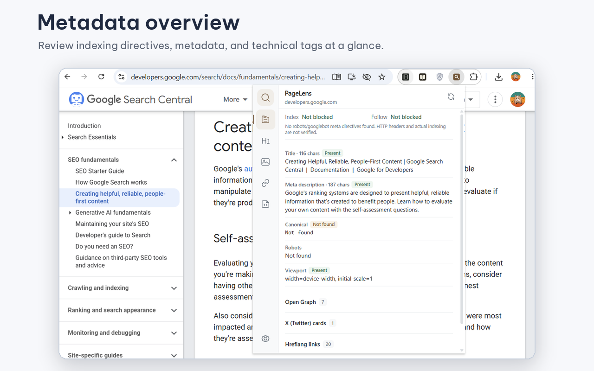
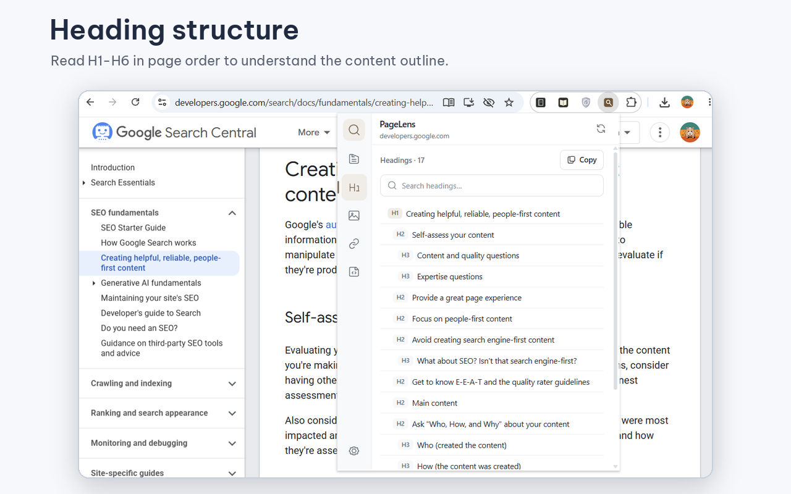
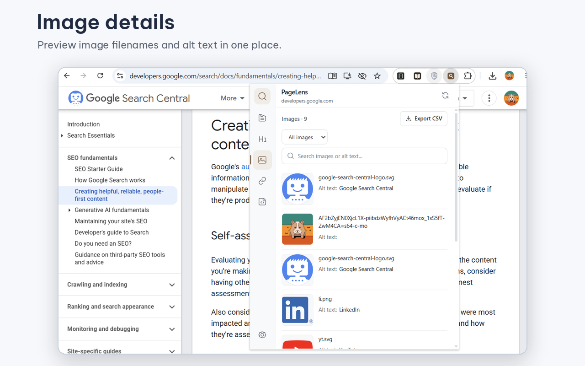
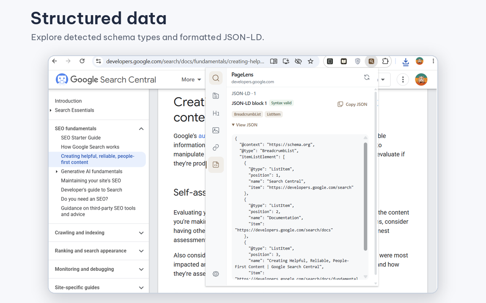
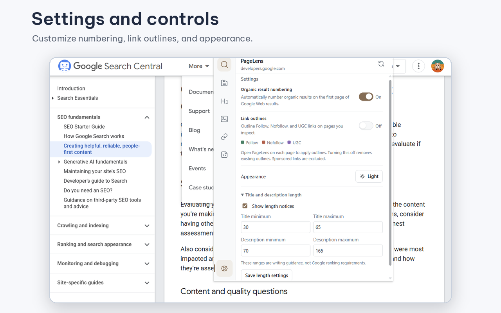

# PageLens

**Understand any webpage in one click.**

PageLens is a free, open-source Chrome extension for checking what is actually on a webpage. Click the toolbar icon to review SEO metadata, headings, image alt text, links, and structured data in a clean, compact popup. No account or SEO score required.

### Download PageLens

**[Download PageLens v1.5.0 for Chrome (.zip)](https://github.com/reika140/pagelens/releases/download/v1.5.0/pagelens-v1.5.0-chrome-extension.zip)**

[Installation steps](#install-in-chrome) · [Release notes](https://github.com/reika140/pagelens/releases/tag/v1.5.0) · [Source ZIP](https://github.com/reika140/pagelens/releases/download/v1.5.0/pagelens-v1.5.0-source.zip)

*Free · Chrome 116+ · Beta release · Chrome Web Store listing coming later*

## See PageLens in action

*Start with the essentials: Index/Follow indications, title, meta description, canonical URL, and more.*

More screenshots: Headings, Images, JSON-LD, and Settings

**Headings — read the page outline at a glance**

**Images — preview each image and its alt text**

**Structured data — explore JSON-LD clearly**

**Settings — choose what you want to see**

*Store artwork is built from authentic Chrome screenshots on a public Google Search Central page, using only local cropping, typography, borders, and shadows. Original captures are preserved in [docs/screenshots/real](docs/screenshots/real). Google does not endorse PageLens.*

## What you can do

- **Check page metadata.** Review indexing directives, title, description, canonical URL, Open Graph tags, X cards, and hreflang.
- **Read the heading structure.** See H1–H6 in page order, search headings, and copy the outline.
- **Inspect images.** See thumbnails, filenames, and alt text; filter results and export CSV.
- **Review links.** Find internal and external links, export them, and run a one-click HTTP status check across the page.
- **Explore JSON-LD.** View structured data types, formatted JSON, and syntax problems.
- **Use optional visual helpers.** Number recognized organic results on supported Google Search pages or outline Follow, Nofollow, and UGC links when you inspect a page.

PageLens reports observations rather than inventing an SEO score. It does not claim that empty alt text is always wrong or that an unverified link is broken.

## Install in Chrome

PageLens is not yet listed in the Chrome Web Store, so installation currently uses Chrome's Developer mode.

1. **[Download the extension ZIP](https://github.com/reika140/pagelens/releases/download/v1.5.0/pagelens-v1.5.0-chrome-extension.zip)** and extract it into a folder.
2. Open <code>chrome://extensions</code> in Chrome and enable **Developer mode**.
3. Click **Load unpacked** and choose the extracted folder containing <code>manifest.json</code>.
4. Open a website and click the **PageLens** icon in the toolbar.

The popup opens directly to Metadata. To update a manually installed build, replace the extracted folder and reload the extension.

## Privacy and a few practical limits

**Your page inspection stays in your browser.** PageLens has no login, developer analytics, or server receiving inspected pages. It uses temporary access to the webpage you choose, plus local storage for your settings. Automatic organic numbering is restricted to supported Google Search domains. [Read the privacy policy](docs/privacy.md).

**HTTP checks are on demand.** PageLens contacts the destination websites only after you select **Check all**. It can check up to 2,000 distinct URLs per run, but cross-origin restrictions can prevent verification; those results are marked *Not verified*. Keep the popup open while checking.

**Link outlines are optional.** Turn them on in Settings, then open PageLens on the website you want to inspect. Outlines do not automatically appear on every website, and no all-sites access is requested.

## For developers

Build from source and run checks

Requires Node.js 20+, npm, and Python 3.10+ for packaging.

~~~bash
git clone https://github.com/reika140/pagelens.git
cd pagelens
npm ci
npm run check
npm run build
npm run package
~~~

Load the generated <code>dist/</code> folder using **Load unpacked**. See [architecture](docs/architecture.md), [contributing](CONTRIBUTING.md), and [the changelog](CHANGELOG.md) for implementation details.

## Help improve PageLens

Found a problem or have an idea? [Open an issue](https://github.com/reika140/pagelens/issues) with a public example and your Chrome version. Please remove private information from screenshots.

PageLens is maintained by [reika140](https://github.com/reika140) and distributed under the [MIT License](LICENSE). Be Vietnam Pro font files use the [SIL Open Font License](THIRD_PARTY_NOTICES.md).

*Version 1.5.0 is a beta release. Chrome Web Store publication is planned but not yet approved.*
