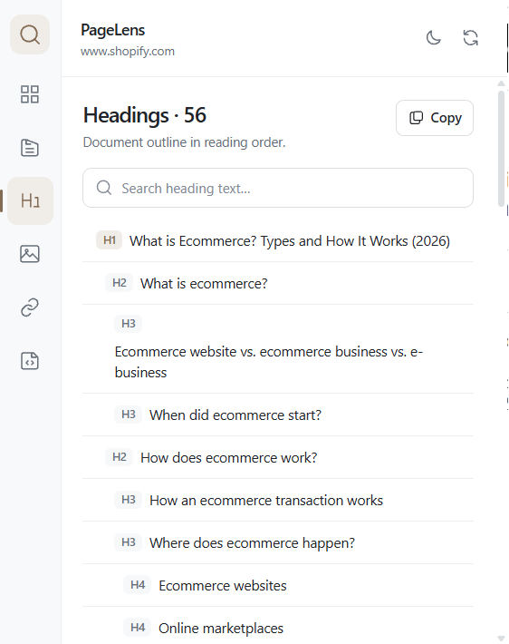
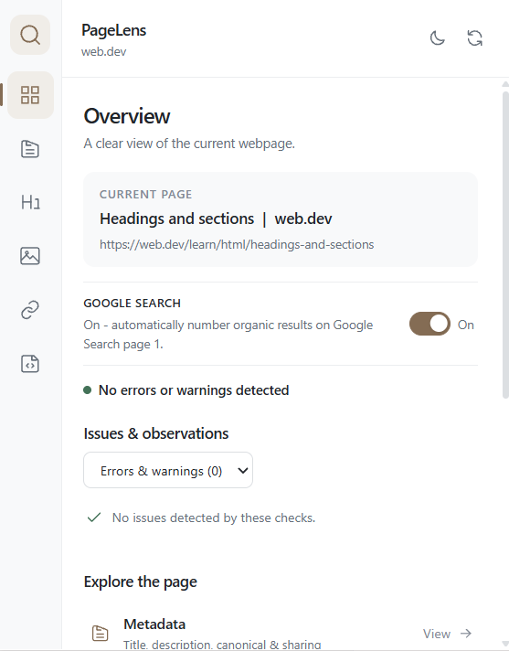
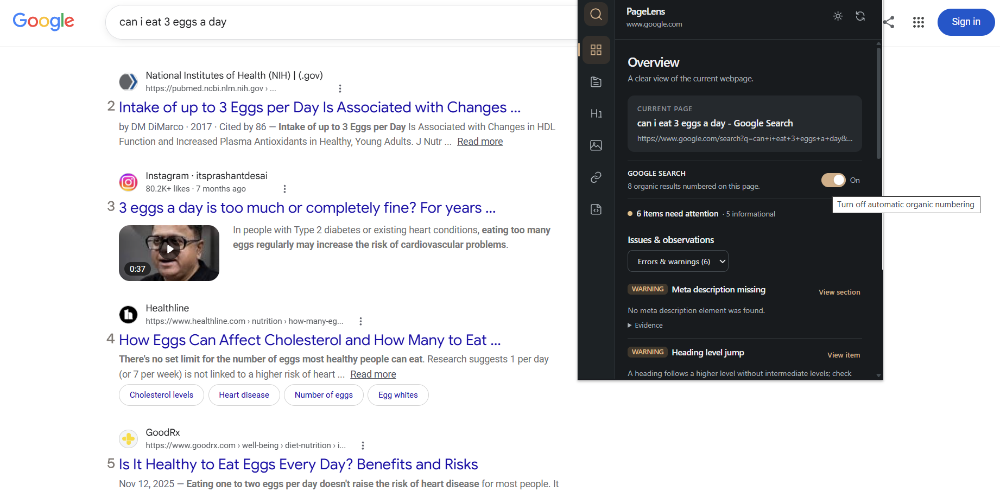

# PageLens

**A clearer look at the page you're on.**

PageLens is a lightweight, open-source Chrome extension for inspecting the details behind a webpage. Open the toolbar popup to review metadata, heading structure, images, links, and JSON-LD without digging through DevTools.

It can also label organic results on Google Search, so the first result is easy to distinguish from ads and other search features.

**Chrome 116+ · Manifest V3 · MIT · [Build status](https://github.com/reika140/pagelens/actions/workflows/ci.yml)**

## In action

<table>
  <tr>
    <td width="50%" valign="top">
      
      <p align="center"><sub>Explore heading structure on Shopify</sub></p>
    </td>
    <td width="50%" valign="top">
      
      <p align="center"><sub>Inspect page details on web.dev</sub></p>
    </td>
  </tr>
</table>

<details>
  <summary>See organic numbering on Google Search</summary>
  <p></p>
  <p><sub>Rank labels reflect the results shown in this browser session and may differ across users and searches.</sub></p>
</details>

*Screenshots captured in Chrome on public websites. The featured sites are examples, not endorsements.*

## What you can do

- **Understand a page at a glance.** See its title, description, canonical URL, robots directives, and relevant observations.
- **Explore the structure.** Browse H1–H6 headings in order, check image alt attributes, and review internal and external links.
- **Inspect structured data.** Read and copy formatted JSON-LD, including syntax errors and detected types.
- **Copy or export useful details.** Copy headings or JSON-LD, and export filtered image and link lists to CSV.
- **See organic positions on Google.** Automatically number recognized organic results on the first Google Search results page, with a simple On/Off switch in the popup.

PageLens reports what it can observe. It does not assign an arbitrary SEO score, claim that every empty alt is an error, or treat unverified links as broken.

## Get started

PageLens is currently available as a **beta build**, not yet through the Chrome Web Store.

1. Open a [successful CI run](https://github.com/reika140/pagelens/actions/workflows/ci.yml) and download the `pagelens-v1.3.3-popup-candidate` artifact (GitHub sign-in may be required).
2. Unzip the artifact, then extract `releases/pagelens-v1.3.3-chrome-extension.zip`.
3. Open `chrome://extensions`, enable **Developer mode**, and choose **Load unpacked**.
4. Select the extracted extension folder containing `manifest.json`.
5. Visit a webpage and click the **PageLens** icon in the Chrome toolbar.

The popup scans the active tab when opened. Its six inspectors are available from the icon navigation on the left.

### Organic numbering on Google

On supported first-page Web searches at `google.com` and `google.com.vn`, PageLens can show organic position numbers without opening the popup. The feature is **on by default** and can be turned off under **Automatic organic ranking numbers**.

The labels are based on the visible page, not a rank-tracking API. Ads, AI Overview citations, and recognizable search features are excluded where they can be identified reliably. Google changes its layouts frequently, so some results may not be recognized.

## Privacy, without the fine print

Page inspections run locally. PageLens has no account, analytics, or developer server, and it does not upload the pages or reports you inspect.

| Access | Why it's needed |
| --- | --- |
| `activeTab` | Inspect the page after you click the extension icon |
| `scripting` | Read that page's DOM for the on-demand inspection |
| `storage` | Remember whether organic numbering is On or Off |
| Google Search page access | Display organic numbers automatically on supported Google domains |

PageLens does **not** request access to every website. Its automatic content script is limited to the declared Google domains. See the [privacy policy](docs/privacy.md) for precise data-handling details.

## Build it yourself

Requires Node.js 20+ and npm.

```bash
git clone https://github.com/reika140/pagelens.git
cd pagelens
npm ci
npm run check
npm run build
```

Load the generated `dist/` directory in Chrome using **Load unpacked**. To create ZIP distributions, run `npm run package` (Python 3.10+ required).

The code uses TypeScript, browser APIs, and no JavaScript runtime dependencies. For browser regression tests, see the [development documentation](docs/architecture.md) and [contribution guide](CONTRIBUTING.md).

## Project status

**v1.3.3 — Beta.** Automated unit, DOM, and popup tests run in [GitHub Actions](https://github.com/reika140/pagelens/actions). Chrome Web Store submission is still pending. Search result classification is best-effort because Google's HTML can change.

If something looks wrong, [open an issue](https://github.com/reika140/pagelens/issues) with a public reproduction page and your Chrome version. Please remove sensitive information from screenshots.

## Contributing and license

Bug reports and focused pull requests are welcome. Start with [CONTRIBUTING.md](CONTRIBUTING.md); security concerns are covered in [SECURITY.md](SECURITY.md).

PageLens is maintained by [reika140](https://github.com/reika140) and released under the [MIT License](LICENSE). Bundled Be Vietnam Pro fonts are licensed separately under OFL-1.1; details are in [THIRD_PARTY_NOTICES.md](THIRD_PARTY_NOTICES.md).
