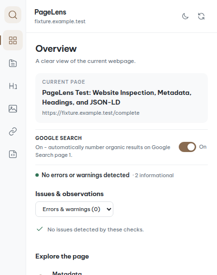

# PageLens

**Understand any webpage in one click.**

PageLens is a local-first, open-source Chrome website inspector maintained by
[reika140](https://github.com/reika140). Click the toolbar icon and PageLens
opens a compact popup to inspect the current webpage. The inspection runs
entirely on your device: no account, server, analytics or arbitrary SEO score.

> **v1.3.3 - Automatic Google numbering beta.** Local compilation and automated browser fixtures are
> verified. Real Chrome installation and the final Chrome Web Store submission
> still require acceptance testing.



*UI preview from compiled PageLens running against a public test fixture. Not a screenshot of an installed Chrome extension.*

## Features

| Inspector | Features |
| --- | --- |
| Overview | Document summary, evidence-based findings and inspector shortcuts |
| Metadata | Title, description, canonical, robots, viewport, Open Graph, Twitter/X and hreflang |
| Headings | H1–H6 hierarchy, skip/empty observations, Copy heading hierarchy |
| Images | Alt missing/empty/present, image sources, lazy-loading data, search and filtered CSV |
| Links | Internal and external links, search, accessible-name observations and filtered CSV |
| Structured Data | JSON-LD syntax parsing, nested `@type`, formatted JSON and Copy |

PageLens treats multiple H1 elements and empty image alt attributes as
**context-dependent** rather than automatic SEO/accessibility errors. Title and
description length recommendations are optional, configurable heuristics. It
does not claim a link is broken without HTTP validation or that valid JSON-LD
qualifies for Google's Rich Results.

## Install on Chrome

**Chrome Desktop 116 or later.**

1. Download and extract `pagelens-v1.3.3-chrome-extension.zip`.
2. Open `chrome://extensions` and enable **Developer mode**.
3. Click **Load unpacked** and select the extracted folder containing
   `manifest.json` at its root.
4. Open a normal HTTP(S) website and click the **PageLens toolbar icon**.
5. PageLens immediately opens its **448 x 568 px popup** and scans the active
   tab. Use the left icon rail to switch between the six inspectors.

### Automatic Google organic numbering

Organic numbers are **On by default** and appear on the first ordinary Web
results page of Google Search at `google.com` or `google.com.vn` without
opening the PageLens popup. Unlike popup scanning, this requires a narrowly
scoped content script that Chrome may ask you to authorize during install or
upgrade. No site-wide access outside the listed Google domains is required.

The organic rank counter skips ads, AI Overview citations, People Also Ask and
other recognizable rich modules; results are numbered in visible top-to-bottom
order. This uses the page's HTML, not an external SERP rank API, and cannot
promise accuracy on every Google layout. Do not interpret these labels as
personalization-free or independently verified rankings.

PageLens draws the numbers as **SVG vector outlines** in a dedicated root-level
layer, separate from Google result cards. It does not inject text labels or
change positioning styles inside Google's organic results. This avoids
result-card font, mirroring and rotation rules affecting the numbers.

In the popup, Overview has one **Automatic organic ranking numbers** On/Off
switch. Its choice is stored locally and applies to subsequent Google searches
without an icon click. Turning it Off also removes existing PageLens number
labels from Google tabs where the content script is running.

The popup closes when you click outside it, as Chrome popups normally do.
Click the toolbar icon again to open a fresh scan of the currently active page.
Results are held only for the lifetime of the open popup; search and scroll state are
preserved while you switch inspectors within that popup.

Export is intentionally contextual: Headings supports Copy, Images and Links
support filtered CSV, and Structured Data supports Copy JSON. The long global
export footer has been removed.

### Appearance

PageLens has a white-first Light theme with restrained sepia accents and a
neutral Dark theme. The locally bundled Be Vietnam Pro font uses Regular,
Medium and SemiBold weights. There are no externally hosted font requests.

## Permissions and privacy

```json
"permissions": ["activeTab", "scripting", "storage"]
```

- `activeTab`: temporary access after a deliberate toolbar click.
- `scripting`: one-shot DOM extraction of the active page.
- `storage`: locally saves the automatic organic numbering On/Off preference.
- `content_scripts.matches`: permits automatic numbering on `google.com` and
  `google.com.vn` only. Chrome may display an access warning for these sites.

There is **no** Side Panel permission, background service worker, broad
`host_permissions`, `tabs` permission, remote code or analytics. PageLens inspects the active document locally. It
does not collect form values or upload website content, URLs, JSON-LD or
exported CSV files. Check exported content before sharing it publicly.

Read the [privacy policy](docs/privacy.md) and [security policy](SECURITY.md).

## Build from source

Requirements: Node.js 20+, npm, TypeScript 5.8.3 (installed by `npm ci`),
Python 3.10+ for packaging, and Playwright/Chromium for optional browser tests.

```bash
npm ci
npm run check
npm run package
```

For browser tests:

```bash
python -m pip install playwright
python -m playwright install chromium
npm run test:browser
npm run test:ui
npm run test:serp
npm run test:auto-serp
```

Build outputs:

- `dist/` — ready-to-load unpacked popup extension
- `releases/pagelens-v1.3.3-chrome-extension.zip` — ZIP for Chrome
- `releases/pagelens-v1.3.3-source.zip` — public source archive
- `releases/SHA256SUMS.txt` — SHA-256 checksums

The code uses strict TypeScript, native Manifest V3 APIs, CSS variables and
zero JavaScript runtime dependencies. The only npm development dependency is
TypeScript. Unit tests use Node's test runner; Chromium test fixtures inspect
actual DOM data and exercise the compiled popup with a Chrome API adapter.

## Project structure

```text
pagelens/
├── .github/             # GitHub Actions, CODEOWNERS and templates
├── assets/              # Icons and locally licensed font files
├── docs/                # Architecture, privacy, QA and Store instructions
├── scripts/             # Build, lint, verification and ZIP packaging
├── src/
│   ├── core/            # Extraction, parsing, rules and exports
│   ├── extension/       # Temporary active-tab access and DOM extraction
│   └── popup/           # Popup UI and navigation
├── styles/              # Typography, inspector layout and popup sizing
├── tests/               # Unit tests, HTML fixtures and Chromium smoke tests
├── LICENSE
└── manifest.json
```

## Limitations and verification

- Scans one active webpage at a time, not whole websites or cross-origin frames.
- Doesn't crawl or request remote link health or Google Rich Results.
- Google labels are derived from the current visible SERP DOM, not a remote
  rank-tracking service; some layouts may not be identifiable.
- Scans are transient. The popup closes when Chrome moves focus elsewhere.
- Chrome blocks scripting of internal pages, the Web Store and some managed sites.
- DOM results may be capped for very large pages, with a corresponding finding.
- Real Chrome installation and toolbar-popup permission behavior must be
  verified in an unrestricted desktop Chrome profile before release.
- Use **genuine installed-Chrome screenshots** for Chrome Web Store submission;
  fixture images in this repository are not Store listing screenshots.

See the [release checklist](docs/release-checklist.md).

## License and ownership

Copyright © 2026 **[reika140](https://github.com/reika140)**.
Released under the [MIT License](LICENSE). See [AUTHORS.md](AUTHORS.md),
[CODEOWNERS](.github/CODEOWNERS), [CONTRIBUTING.md](CONTRIBUTING.md), and
[THIRD_PARTY_NOTICES.md](THIRD_PARTY_NOTICES.md) for attribution and licensing.

### Popup sizing

The action popup is fixed at 448 × 568 CSS pixels. The document does not
use viewport-relative width/height constraints because Chrome auto-sizes the
popup from its intrinsic content size.
